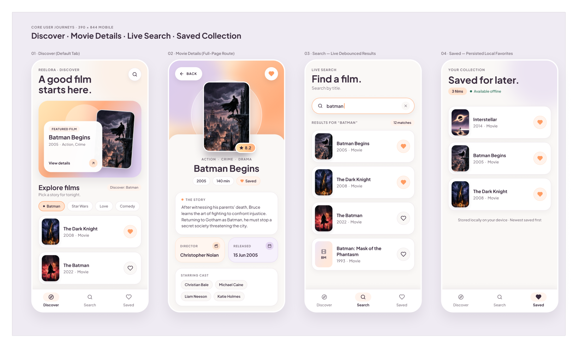
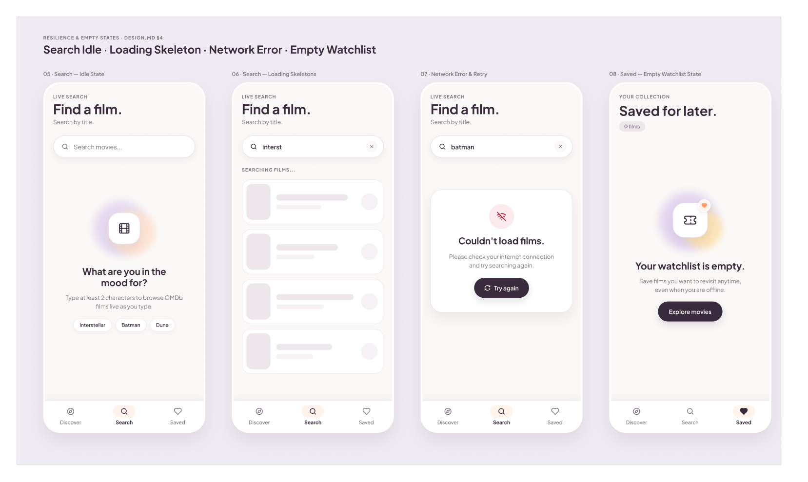

# Movie Muse

<p align="center">
  
</p>

Movie Muse adalah aplikasi yang digunakan untuk melihat daftar film, mencari film, melihat detail film, dan menyimpan film favorit. Aplikasi ini dibangun menggunakan Flutter dengan arsitektur MVVM (Model View ViewModel) yang dipadukan dengan Clean Architecture (lapisan `presentation`, `domain`, dan `data`). Data film diambil dari [OMDb API](https://www.omdbapi.com/).

## Fitur

- **Discover**: daftar film dari OMDb (kata kunci awal `Batman`), kartu film unggulan, dan chip kata kunci cepat.
- **Detail Film**: poster, rating IMDb, sinopsis, sutradara, tanggal rilis, dan pemeran, dengan efek parallax saat scroll.
- **Pencarian Langsung**: hasil muncul otomatis saat mengetik (debounce 450 ms, minimal 2 karakter), respons lama tidak menimpa hasil terbaru.
- **Favorit**: simpan dan hapus film favorit, tersimpan di perangkat dan tetap ada setelah aplikasi ditutup.

## Arsitektur

```text
lib/
├── app/        # tema, router, dependency injection
├── core/       # config, error, network, widget bersama
└── features/
    ├── movies/ # domain + data (OMDb & favorit)
    ├── shell/  # navigasi bawah
    ├── discover/
    ├── detail/
    ├── search/
    └── saved/
```

Alur: `View` → `ViewModel` (ChangeNotifier) → `UseCase` → `Repository` → `DataSource` (OMDb HTTPS / SharedPreferences).

## Library yang Digunakan

- [provider](https://pub.dev/packages/provider), yaitu library untuk state management ViewModel (`ChangeNotifier`) ke widget.
- [get_it](https://pub.dev/packages/get_it), yaitu library untuk dependency injection.
- [go_router](https://pub.dev/packages/go_router), digunakan untuk navigasi antar halaman.
- [dio](https://pub.dev/packages/dio), yaitu library yang digunakan untuk melakukan http request ke OMDb API.
- [shared_preferences](https://pub.dev/packages/shared_preferences), digunakan untuk menyimpan daftar film favorit secara lokal.
- [equatable](https://pub.dev/packages/equatable), digunakan untuk membandingkan entity dengan mudah.
- [google_fonts](https://pub.dev/packages/google_fonts), digunakan untuk font Plus Jakarta Sans.
- [mocktail](https://pub.dev/packages/mocktail), digunakan untuk membuat mock pada unit test.

## Tampilan Aplikasi

### Desain UI (Figma)

Desain layar utama: Discover, Detail Film, Pencarian, dan Favorit.



Desain state: pencarian kosong, loading, error jaringan, dan favorit kosong.



Screenshot dari aplikasi yang berjalan akan ditambahkan di bagian ini.

## Download APK

Link download APK akan ditambahkan di bagian [Releases](https://github.com/rikoarik/movie-muse/releases) setelah build release selesai.

## Cara Menjalankan

1. Dapatkan API key di [omdbapi.com](https://www.omdbapi.com/).
2. Install dependency:
   ```bash
   flutter pub get
   ```
3. Jalankan aplikasi:
   ```bash
   flutter run --dart-define=OMDB_API_KEY=YOUR_KEY
   ```
4. Jalankan analisis dan test:
   ```bash
   flutter analyze
   flutter test
   ```
5. Build APK release:
   ```bash
   flutter build apk --release --dart-define=OMDB_API_KEY=YOUR_KEY
   ```

> API key tidak disimpan di repository. Lewat `--dart-define`, key masih bisa diekstrak dari APK, jadi jangan dianggap rahasia untuk produksi.

## Dokumentasi

Dokumen desain dan kebutuhan ada di folder [`docs/`](docs/README.md).
