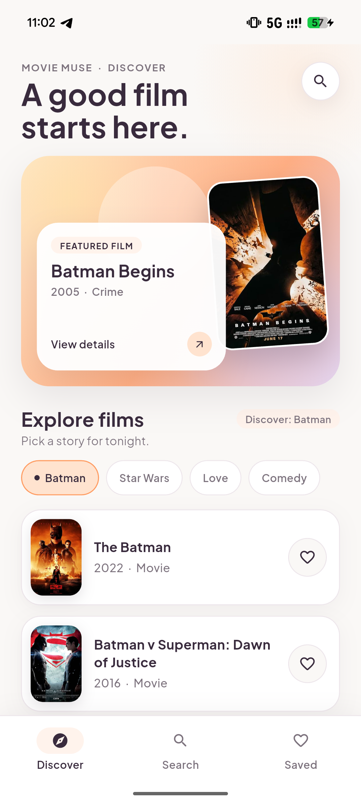
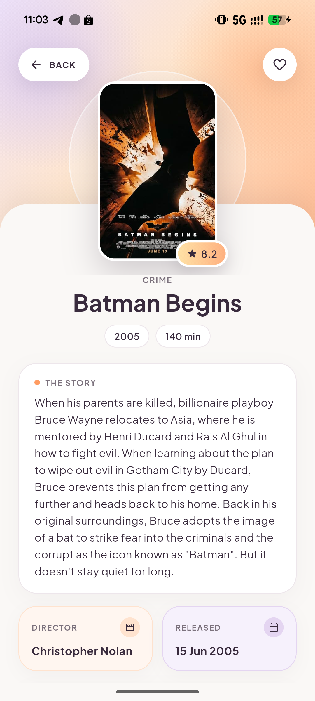
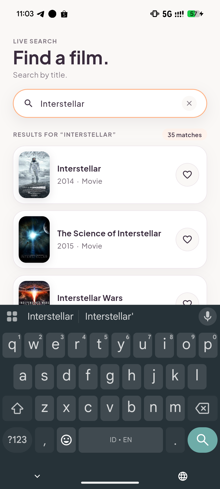
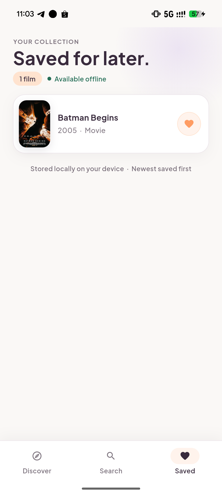

# Movie Muse

<p align="center">
  
</p>

Movie Muse adalah aplikasi yang digunakan untuk melihat daftar film, mencari film, melihat detail film, dan menyimpan film favorit. Aplikasi ini dibangun menggunakan Flutter dengan arsitektur MVVM (Model View ViewModel) yang dipadukan dengan Clean Architecture (lapisan `presentation`, `domain`, dan `data`). Data film diambil dari [OMDb API](https://www.omdbapi.com/).

## Fitur

- **Discover**: daftar film dari OMDb (kata kunci awal `Batman`), kartu film unggulan, dan chip kata kunci cepat.
- **Detail Film**: poster, rating IMDb, sinopsis, sutradara, tanggal rilis, dan pemeran, dengan efek parallax saat scroll.
- **Pencarian Langsung**: hasil muncul otomatis saat mengetik (debounce 450 ms, minimal 2 karakter), respons lama tidak menimpa hasil terbaru.
- **Favorit**: simpan dan hapus film favorit, tersimpan di perangkat dan tetap ada setelah aplikasi ditutup.

## Arsitektur

```text
lib/
├── app/        # tema, router, dependency injection
├── core/       # config, error, network, widget bersama
└── features/
    ├── movies/ # domain + data (OMDb & favorit)
    ├── shell/  # navigasi bawah
    ├── discover/
    ├── detail/
    ├── search/
    └── saved/
```

Alur: `View` → `ViewModel` (ChangeNotifier) → `UseCase` → `Repository` → `DataSource` (OMDb HTTPS / SharedPreferences).

## Library yang Digunakan

- [provider](https://pub.dev/packages/provider), yaitu library untuk state management ViewModel (`ChangeNotifier`) ke widget.
- [get_it](https://pub.dev/packages/get_it), yaitu library untuk dependency injection.
- [go_router](https://pub.dev/packages/go_router), digunakan untuk navigasi antar halaman.
- [dio](https://pub.dev/packages/dio), yaitu library yang digunakan untuk melakukan http request ke OMDb API.
- [shared_preferences](https://pub.dev/packages/shared_preferences), digunakan untuk menyimpan daftar film favorit secara lokal.
- [equatable](https://pub.dev/packages/equatable), digunakan untuk membandingkan entity dengan mudah.
- [google_fonts](https://pub.dev/packages/google_fonts), digunakan untuk font Plus Jakarta Sans.
- [mocktail](https://pub.dev/packages/mocktail), digunakan untuk membuat mock pada unit test.

## Tampilan Aplikasi

Tangkapan layar dari APK release di Android.

| Discover | Detail Film | Live Search | Favorit |
| --- | --- | --- | --- |
|  |  |  |  |

## Download APK

[Unduh APK Android v1.0.0](https://github.com/rikoarik/movie-muse/releases/download/v1.0.0/Movie-Muse-v1.0.0.apk) · [GitHub Releases](https://github.com/rikoarik/movie-muse/releases)

APK sudah dikonfigurasi untuk mengakses OMDb setelah diinstal.

## Cara Menjalankan

Diuji dengan Flutter 3.47.5, Dart 3.13.4, dan Android SDK 36.

1. Aktifkan API key dari [OMDb](https://www.omdbapi.com/apikey.aspx). Salin konfigurasi contoh dan isi `OMDB_API_KEY` di file `.env`.
   ```bash
   cp .env.example .env
   ```
2. Instal dependensi dan jalankan aplikasi.
   ```bash
   flutter pub get
   flutter run --dart-define-from-file=.env
   ```
3. Jalankan analisis dan tes.
   ```bash
   flutter analyze
   flutter test
   ```
4. Buat APK release.
   ```bash
   flutter build apk --release --dart-define-from-file=.env
   ```

Hasil build ada di `build/app/outputs/flutter-apk/app-release.apk`. File `.env` disimpan lokal. Gunakan key khusus distribusi karena key yang dipakai saat build dapat diekstrak dari APK.

## Dokumentasi

Dokumen desain dan kebutuhan ada di folder [`docs/`](docs/README.md).
