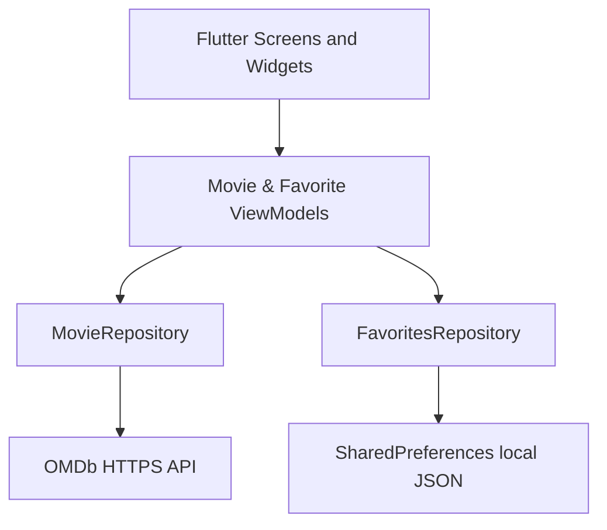

# ARCHITECTURE.md — Movie Muse

> Lightweight MVVM architecture · Flutter · OMDb API · Local favorites

## 1. Design decisions

The task is small and time-limited. Choose one feature-oriented Flutter application with **MVVM + repositories**. Do not add Clean Architecture layers, code generation, dependency-injection containers, offline movie caching or a backend solely for this test.



**Direction of dependency:** widgets observe view models → view models use repository interfaces → repositories own API/storage. Repositories do not import widget code.

## 2. Suggested project structure

```text
lib/
├── main.dart
├── app.dart
├── core/
│   ├── theme/app_theme.dart
│   ├── config/app_config.dart
│   ├── network/omdb_client.dart
│   ├── utils/api_exception.dart
│   └── widgets/{movie_tile,poster_image,empty_state,error_state}.dart
├── models/
│   ├── movie_summary.dart
│   ├── movie_detail.dart
│   └── movie_search_result.dart
├── repositories/
│   ├── movie_repository.dart
│   └── favorites_repository.dart
├── viewmodels/
│   ├── discover_viewmodel.dart
│   ├── search_viewmodel.dart
│   ├── movie_detail_viewmodel.dart
│   └── favorites_viewmodel.dart
└── features/
    ├── shell/main_shell.dart
    ├── discover/discover_screen.dart
    ├── search/search_screen.dart
    ├── detail/movie_detail_screen.dart
    └── saved/saved_screen.dart

test/
├── models/movie_parsing_test.dart
├── viewmodels/search_viewmodel_test.dart
└── repositories/favorites_repository_test.dart
```

File names and exact state-management package are adaptable. Prefer Flutter built-in `ChangeNotifier` + `ListenableBuilder` (or `AnimatedBuilder`) and constructor injection. A shared FavoritesViewModel instance must be passed to every screen needing favorite state.

## 3. Key models

```dart
class MovieSummary {
  final String imdbId;
  final String title;
  final String year;
  final String? poster;
  final String? type;
}

class MovieDetail {
  final String imdbId;
  final String title;
  final String year;
  final String? poster;
  final String? plot;
  final String? genre;
  final String? director;
  final String? actors;
  final String? runtime;
  final String? imdbRating;
  final String? released;
}

class MovieSearchResult {
  final List<MovieSummary> movies;
  final int totalResults;
}
```

JSON mapping must explicitly translate API field names (`imdbID`, `Title`, `Year`, `Poster`, `Type`, `Plot`, etc.) and normalize missing/blank/`N/A` values. `MovieSummary.imdbId` may never be empty for actionable results.

## 4. State & responsibility

| Component | Owns | Must not own |
|---|---|---|
| `DiscoverViewModel` | Default search query, loading, list, error | HTTP headers, widget context |
| `SearchViewModel` | Query, debounce timer, generation token, results | Local favorites serialization |
| `MovieDetailViewModel` | Selected ID, detail request, loading/error | Navigation |
| `FavoritesViewModel` | `Set<String>` of saved IDs, saved summary list, persistence operations | API parsing |
| `MovieRepository` | Search/detail fetch, response normalization and errors | Animation and UI |
| `FavoritesRepository` | Local read/write (JSON), deduplication | API calls |

**Initialization:** create MovieRepository, FavoritesRepository, and shared FavoritesViewModel once in the root app. Await `favorites.load()` before considering favorites state ready. Screens may show a short progress indicator during load.

## 5. Network behavior

- Base URL: `https://www.omdbapi.com/`.
- Search: `GET /?apikey=<key>&s=<query>&type=movie&page=<n>`.
- Detail: `GET /?apikey=<key>&i=<imdbID>&plot=full`.
- Check HTTP status, JSON object shape, and OMDb `Response` field: a successful HTTP 200 may still mean an OMDb error.
- Map `Movie not found!` / no matches into empty state, `Invalid API key!` into actionable configuration error, and transport failures into retryable network errors.
- Optional timeout: 12 seconds; no aggressive automatic retry loops.
- Never log the full URL when it includes the `apikey` query string.

### Debounce and stale-result prevention

```text
onQueryChanged(text):
  cancel pending debounce timer
  increment requestGeneration
  normalized = text.trim()
  if normalized.length < 2: clear results + show idle; return
  schedule after 450ms:
    capturedGeneration = requestGeneration
    set loading
    result = await repository.search(normalized)
    if capturedGeneration != requestGeneration: discard result
    else: update state (results / empty / error)
```

Ensure view models cancel timers in `dispose()`. Optionally use an HTTP cancellation mechanism, but **generation matching is required** even when requests cannot be cancelled.

## 6. Favorites persistence

**Storage key:** `favorite_movies_v1`.

**Format:** One JSON array of saved `MovieSummary` records.

```json
[
  {
    "imdbId": "tt0372784",
    "title": "Batman Begins",
    "year": "2005",
    "poster": null,
    "type": "movie"
  }
]
```

This sample shows the storage shape, not an assertion about the API's current poster value. Load once, keep state in memory, write on toggle, and notify listeners after a successful write (or roll back if write fails). Deduplicate records by `imdbId`. A corrupted JSON payload must not crash the app. The Saved list uses local summaries without a network dependency; tapping an item may fetch detail from OMDb.

## 7. Navigation strategy

Use a `Scaffold` shell with `IndexedStack` for Discover, Search, Saved; push detail with Navigator to keep underlying tab state. Detail accepts only an IMDb ID and optionally the summary for an instant preview. Use `Hero` animations only when tags are unique across routes and no runtime assertion occurs.

## 8. Tradeoffs / ADR

| Decision | Chosen | Rejected | Reason |
|---|---|---|---|
| State | `ChangeNotifier` | Full BLoC setup | Less boilerplate for 4-hour task |
| Persistence | SharedPreferences JSON | SQLite/Isar | Few small favorite records |
| API | Direct OMDb via HTTPS | Custom backend | No backend required by assignment |
| Home data | Fixed labeled search term | Fake trending API | Reflects actual OMDb capability |
| Search | Debounce + generation counter | Every-keystroke request | Fewer requests and correct ordering |
| UI | `DESIGN.md` tokens | Pixel copying health UI | Adapt reference to movie-specific experience |

## 9. Architecture acceptance

- [ ] UI contains no raw `http.get` calls or SharedPreferences mutations.
- [ ] Repositories are testable with fake client/storage adapters.
- [ ] Search can ignore older responses.
- [ ] Favorites change in all tabs from one shared source of truth.
- [ ] No credentials are committed, and API keys do not appear in debug logging.
